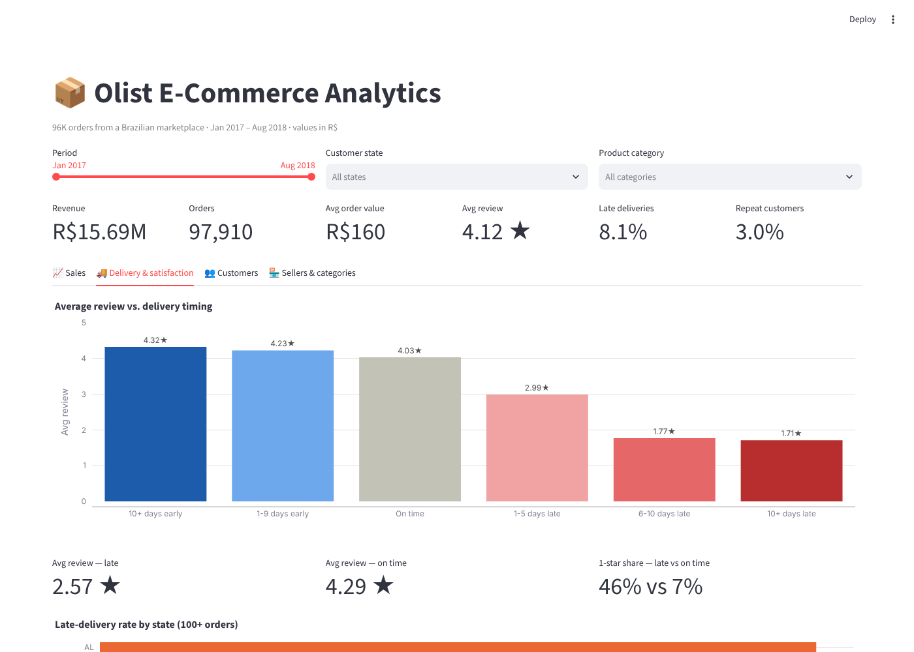
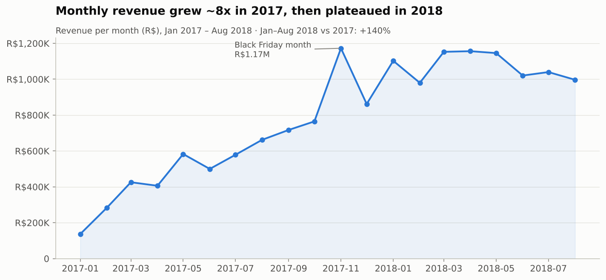
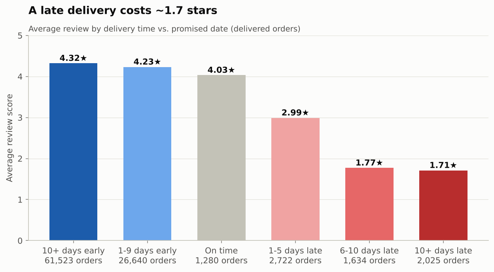
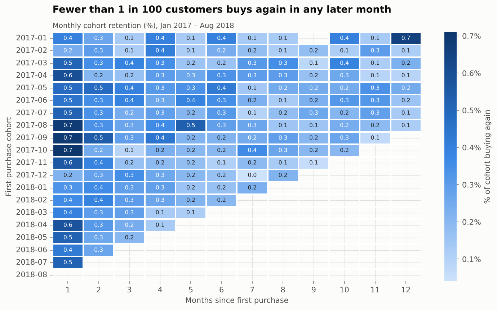
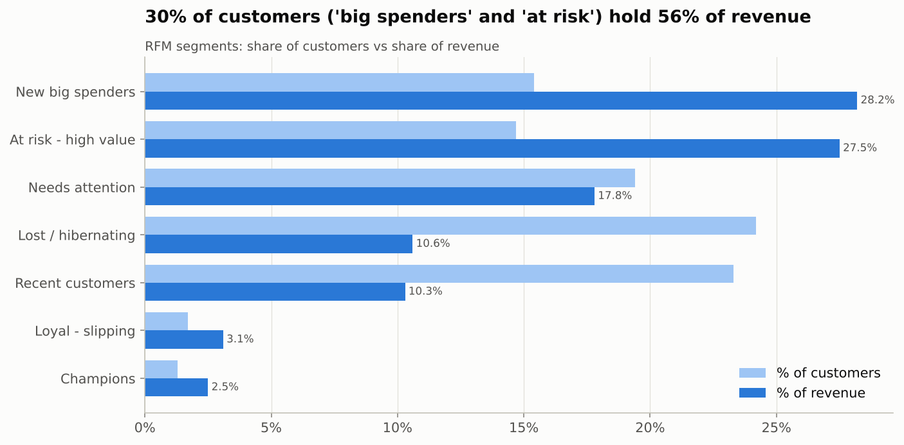
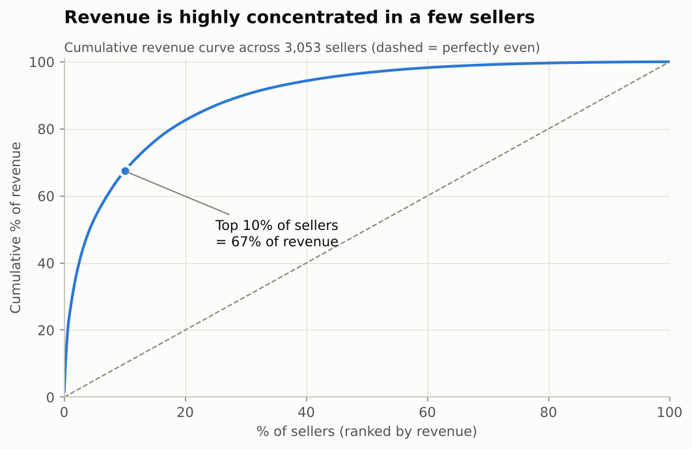
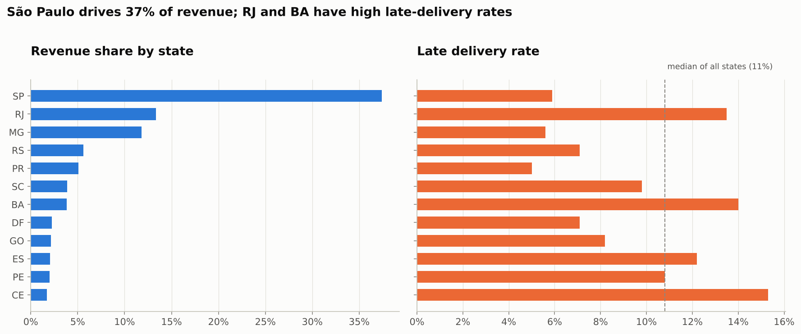

# 📦 Olist E-Commerce Analysis: Sales, Delivery & Customer Insights

End-to-end data analysis of **~100K real orders** from Olist, a Brazilian e-commerce marketplace.
It uses SQL, Python and an interactive dashboard to answer one question: **what drives revenue
and customer satisfaction, and what should the business fix first?**



**Tech stack:** SQL (DuckDB) · Python (pandas, matplotlib, seaborn) · Plotly · Streamlit · Jupyter

---

## 🔑 Key findings

| | Finding |
|---|---|
| 🚚 | **Late deliveries are the #1 driver of bad reviews.** Late orders average **2.57★ vs 4.29★** for on-time orders, and **46% of late orders get 1 star** (vs 7%). |
| 🔁 | **97% of customers never order again.** Month-1 retention is under 1% for every cohort, which explains why revenue **plateaued in 2018** after 140% YoY growth. |
| 💰 | **30% of customers hold 56% of revenue.** The "At risk – high value" segment alone (14% of customers) accounts for **R$4.3M (27.5%)** of revenue but hasn't bought in ~15 months. |
| 🏪 | **The top 10% of sellers generate 67% of revenue**, and the top 1% (31 sellers) generate 26%. That's a concentration risk. |
| 🗺️ | **Rio de Janeiro is the #2 market (13% of revenue) but has 2.3× São Paulo's late-delivery rate** (13.5% vs 5.9%). |
| 🛍️ | **Black Friday 2017 brought 6.3× a normal day's orders**, the biggest single sales event in the data. |

## 💡 Recommendations

1. **Fix delivery reliability first.** Add alerts for orders at risk of missing their estimate, coach or penalise chronically late sellers, and review carriers for RJ and the northeast. *Halving late deliveries would lift the average rating from 4.12 to ~4.19 and cut 1-star reviews by ~16%.*
2. **Launch a second-purchase programme.** Use post-purchase emails and coupons aimed at the 30–60 day window. *Each +1 point of repeat rate ≈ R$118K/year.*
3. **Run a win-back campaign** for the "At risk – high value" segment (~14K customers, R$309 average spend).
4. **Create a key-account programme** for top sellers, plus quality reviews for high-revenue, low-rating sellers.
5. **Plan for peak season.** Black Friday volume needs inventory and carrier capacity booked in advance.

---

## 📊 Analysis highlights

| Revenue trend | Delivery vs review |
|---|---|
|  |  |

| Cohort retention | RFM segments |
|---|---|
|  |  |

| Seller concentration | Regional performance |
|---|---|
|  |  |

The full walkthrough, with commentary for every chart, is in
[`notebooks/olist_analysis.ipynb`](notebooks/olist_analysis.ipynb).

---

## 🗂️ Project structure

```
olist-ecommerce-analysis/
├── scripts/
│   ├── download_data.py          # 1. download the 9 raw CSVs
│   ├── build_database.py         # 2. load into DuckDB + build clean tables & fct_orders
│   ├── run_queries.py            # 3. run all SQL files -> sql/results/*.csv
│   ├── build_notebook.py         # generates the analysis notebook
│   ├── export_dashboard_data.py  # compact Parquet extract for the dashboard
│   └── viz_style.py              # shared chart style
├── sql/                          # 16 business questions answered in SQL
│   └── results/                  # query outputs (CSV)
├── notebooks/olist_analysis.ipynb
├── dashboard/
│   ├── app.py                    # Streamlit dashboard (4 tabs, filters)
│   └── data/                     # Parquet extract (~7 MB)
└── images/                       # charts used in this README
```

### Data model

The 9 raw tables are cleaned into typed tables, then joined into one analysis-ready fact table:

```
customers ─┐
orders ────┼──► fct_orders  (1 row per order: value, items, payment, delivery metrics, review)
order_items┤
payments ──┤        + products (English categories) · sellers · reviews (deduplicated)
reviews ───┘
```

**Data cleaning handled:** duplicate reviews per order (551 removed), Portuguese → English
category names, misspelled source columns, zip codes with lost leading zeros, `not_defined`
payment types, and incomplete months at the start and end of the date range (excluded from trends).

## 🧮 SQL techniques used

| Technique | Where |
|---|---|
| CTEs, multi-table joins | all queries |
| Window functions: `LAG`, `RANK`, `DENSE_RANK`, running `SUM() OVER` | [02](sql/02_monthly_revenue_growth.sql), [04](sql/04_top_categories.sql), [10](sql/10_seller_scorecard.sql) |
| `NTILE` / `PERCENT_RANK` scoring | [09 seller Pareto](sql/09_seller_pareto.sql), [13 RFM](sql/13_rfm_segmentation.sql) |
| Cohort analysis with `DATE_DIFF` | [12 cohort retention](sql/12_cohort_retention.sql) |
| `QUALIFY` deduplication, `FILTER`, `ARG_MAX` | [build_database.py](scripts/build_database.py), [01](sql/01_kpi_overview.sql) |
| `CASE` bucketing and segmentation | [07](sql/07_delivery_vs_review.sql), [13](sql/13_rfm_segmentation.sql) |

<details>
<summary><b>All 16 business questions</b></summary>

1. Headline KPIs: revenue, orders, AOV, rating, late rate
2. Monthly revenue and month-over-month growth
3. Year-over-year comparison (Jan–Aug)
4. Top categories with revenue share and cumulative share
5. Revenue, delivery speed and satisfaction by state
6. Payment method mix and installments
7. Review score by delivery timing bucket
8. Late vs on-time summary
9. Seller revenue concentration (Pareto)
10. Seller scorecard with quality flags
11. One-time vs repeat customers
12. Monthly cohort retention
13. RFM customer segmentation
14. Orders by weekday and time of day
15. Category health: freight burden and satisfaction
16. Black Friday impact
</details>

---

## ▶️ How to run

```bash
git clone https://github.com/Jugalpatel3981/olist-ecommerce-analysis.git
cd olist-ecommerce-analysis
pip install -r requirements.txt

python scripts/download_data.py      # ~120 MB of CSVs
python scripts/build_database.py     # builds data/olist.duckdb
python scripts/run_queries.py        # runs all 16 SQL queries

streamlit run dashboard/app.py       # opens the dashboard at localhost:8501
```

The dashboard only needs the Parquet files in `dashboard/data/`, so it runs right after
`pip install` (and deploys as-is to [Streamlit Community Cloud](https://streamlit.io/cloud)).

## 📁 Dataset

[Brazilian E-Commerce Public Dataset by Olist](https://www.kaggle.com/datasets/olistbr/brazilian-ecommerce)
(CC BY-NC-SA 4.0): 99,441 orders placed Sep 2016 – Oct 2018, with customers, sellers, products,
payments, reviews and geolocation. All monetary values are in Brazilian reais (R$).
